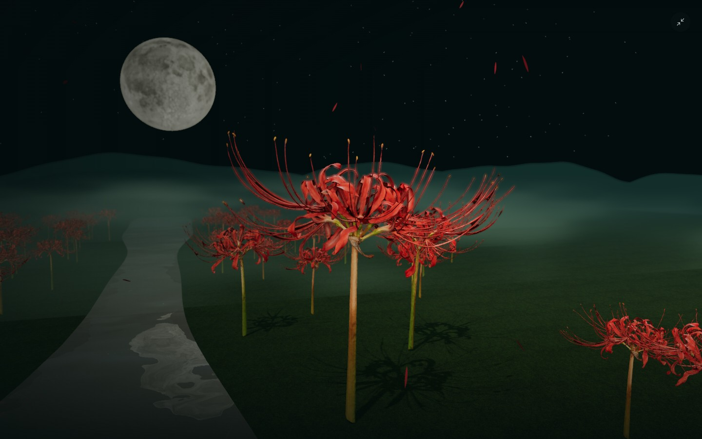

# 彼岸 · The Other Shore

开源许可：本项目原创源代码采用 [MIT License](./LICENSE)。模型、字体、纹理和依赖的许可分别见 [ASSET-CREDITS.md](./ASSET-CREDITS.md) 与 [THIRD-PARTY-LICENSES.md](./THIRD-PARTY-LICENSES.md)。

可交互的彼岸花 3D 场景。Three.js 实时渲染真实扫描花朵、镜面水面、月亮和薄雾。



[下载单文件 HTML](https://github.com/Elysian-x-ai/other-shore-lycoris/raw/refs/heads/main/%E5%BD%BC%E5%B2%B8%E8%8A%B1-%E5%86%99%E5%AE%9E%E7%89%88.html)（约 17 MB），保存后用现代浏览器打开。

## 运行

需要 Node.js 20.19+ 或 22.12+。

```sh
npm ci
npm run dev
```

生产构建：`npm run build`。构建结果在 `dist/`，可部署到静态网站服务。

单文件导出：`npm run build:html`。会在项目根目录生成 `彼岸花-写实版.html`，代码、模型、图片和字体均嵌入文件，可断网双击打开，不需要启动服务器。安卓请将文件下载后用 Chrome 打开，微信附件预览可能不执行页面脚本。

仓库中也保留了最近一次构建的 `彼岸花-写实版.html`，便于直接下载体验。

## 交互

- 月下、余烬、入雾：切换花色、环境光、月色、雾和水面色调。
- 入此花境：隐藏界面并推进镜头。右上角退出，或按 Escape。
- 鼠标移动 / 手指拖动：轻微镜头视差。
- 环境音：按需启动本地 Web Audio 合成音景，默认静音。
- 暂停、全屏、保存此刻：暂停动画、切换浏览器全屏、下载无界面的场景 PNG。
- 尊重系统减少动态效果偏好，初始暂停。

## 资源

- `src/flowers.js`：真实彼岸花扫描模型，近景、中景、远景使用三级几何精度，共享摄影纹理。CC0 标本来源及处理记录见 `ASSET-CREDITS.md`。
- `src/assets/moon.jpg`：Three.js examples 月面纹理，https://threejs.org/examples/textures/planets/moon_1024.jpg 。
- `src/assets/waternormals.jpg`：Three.js examples 水面法线，https://threejs.org/examples/textures/waternormals.jpg 。
- `src/assets/ground.jpg`：Three.js examples 地面纹理，源素材为 qubodup 与 davis123 的 CC BY 3.0 资源，出处见 [ASSET-CREDITS.md](./ASSET-CREDITS.md)。
- `src/assets/noto-serif-sc-*.ttf`：Noto Serif SC 页面字符子集，SIL Open Font License 1.1。字体来源：https://fonts.google.com/noto/specimen/Noto+Serif+SC 。
- Lucide 图标，ISC License；Three.js，MIT License。软件依赖许可证随各 npm 包提供。

所有运行资源均在本地，无需 API 密钥。首次安装依赖需要联网。运行时需要支持 WebGL 2 的现代浏览器，建议开启图形加速。
